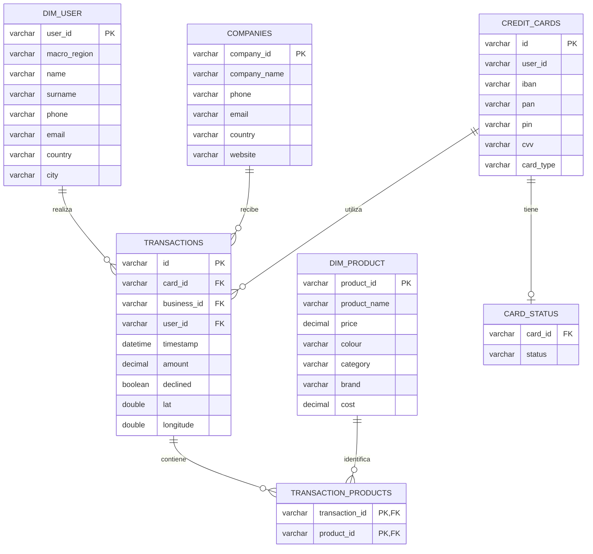

# 🗄️ Sprint 2.2 – SQL | Bases de datos relacionales y modelado de datos

## 📌 Descripción del proyecto

Este proyecto forma parte de mi formación en análisis de datos y tiene como finalidad consolidar los conocimientos fundamentales de SQL mediante la creación, gestión, transformación y consulta de bases de datos relacionales utilizando **MySQL**.

El ejercicio parte de un conjunto de datos de una empresa dedicada a la venta de productos online. A través de diferentes niveles de dificultad, se trabaja con información relacionada con usuarios, empresas, tarjetas de crédito, transacciones comerciales y productos.

Esta entrega corresponde a una **versión revisada y mejorada del proyecto inicial**, en la que se han tenido en cuenta las correcciones y la retroalimentación proporcionadas por la profesora. El objetivo es mejorar la calidad de las consultas, la estructura de las tablas, las relaciones entre entidades y la aplicación de buenas prácticas SQL.

Además de resolver los ejercicios propuestos, el proyecto permite trabajar con diferentes técnicas de modelado de datos, incluyendo el diseño de un esquema en estrella (*Star Schema*), la normalización de relaciones y la preparación de información para su análisis.

---

## 🎯 Objetivos del proyecto

- Construir y gestionar bases de datos relacionales con MySQL.
- Comprender la estructura de un esquema relacional y las relaciones entre tablas.
- Crear tablas y establecer claves primarias y foráneas.
- Importar y transformar información mediante código SQL.
- Realizar consultas utilizando `JOIN` y subconsultas.
- Manipular registros mediante operaciones de inserción, actualización y eliminación.
- Modificar estructuras de tablas mediante sentencias DDL.
- Crear vistas para facilitar el acceso a información empresarial.
- Diseñar una base de datos con un modelo en estrella.
- Aplicar técnicas de normalización para resolver relaciones muchos a muchos.
- Utilizar funciones de agregación, condiciones y funciones de ventana.
- Extraer información relevante para apoyar la toma de decisiones empresariales.

---

## 🛠️ Tecnologías y herramientas

| Tecnología | Aplicación |
|---|---|
| MySQL | Creación y gestión de bases de datos. |
| MySQL Workbench | Desarrollo, ejecución y visualización de consultas SQL. |
| SQL | Manipulación, transformación y análisis de datos. |
| CSV | Archivos fuente para la importación de información. |
| GitHub | Control de versiones y documentación del proyecto. |
| Mermaid | Representación gráfica del modelo de datos. |

---

## 📚 Desarrollo del proyecto

El proyecto está organizado en tres niveles progresivos.

### 🟢 Nivel 1 – Fundamentos de bases de datos relacionales

En esta primera fase se trabajan los conceptos esenciales para construir, consultar y modificar una base de datos.

**Ejercicio 1. Estructura e importación de datos**
- Importación de las tablas iniciales mediante sentencias SQL.
- Identificación de las características del esquema.
- Análisis de las tablas, campos y tipos de datos.
- Representación de las relaciones mediante un diagrama entidad-relación.

**Ejercicio 2. Consultas utilizando JOIN**
- Identificación de los países que generan ventas.
- Cálculo del número de países desde los que se generan ventas.
- Identificación de la compañía con mayor promedio de ventas.

**Ejercicio 3. Consultas mediante subconsultas**
- Identificación de las transacciones realizadas por empresas de Alemania.
- Búsqueda de empresas con transacciones superiores al importe medio global.
- Identificación de empresas sin transacciones registradas mediante `NOT EXISTS`.

**Ejercicio 4. Creación de la tabla credit_card**
- Diseño y creación de la tabla de tarjetas de crédito.
- Definición de la clave primaria.
- Establecimiento de relaciones con las tablas correspondientes.
- Inserción de datos.
- Transformación de fechas y modificación de tipos de datos.

**Ejercicios 5, 6 y 7. Manipulación de datos**
- Actualización del IBAN de una tarjeta de crédito.
- Inserción de una nueva transacción y de los registros relacionados necesarios.
- Eliminación de la columna PAN de la tabla de tarjetas.

**Ejercicio 8. Diseño de una base de datos con esquema en estrella**
- Creación de una nueva base de datos.
- Importación de archivos CSV mediante `LOAD DATA LOCAL INFILE`.
- Unificación de usuarios americanos y europeos.
- Creación de dimensiones y tabla de hechos.
- Definición de las relaciones entre las entidades.
- Preparación de la estructura para posteriores consultas analíticas.

**Ejercicios 9 y 10. Consultas analíticas**
- Identificación de usuarios con más de 80 transacciones mediante subconsultas.
- Cálculo del importe medio de las transacciones por IBAN para la empresa Donec Ltd.

### 🟡 Nivel 2 – Consultas avanzadas y gestión de información

En esta fase se desarrollan consultas orientadas a obtener indicadores relevantes para diferentes departamentos de la empresa.

**Ejercicio 1. Análisis de ingresos**
- Identificación de los cinco días con mayores ingresos por ventas.
- Agrupación de transacciones por fecha.
- Aplicación de `SUM()`, `GROUP BY` y `ORDER BY`.

**Ejercicio 2. Análisis de transacciones**
- Identificación de empresas que realizaron operaciones entre 350 y 400 euros.
- Filtrado por fechas específicas.
- Presentación de información corporativa y económica.
- Ordenación de resultados de mayor a menor importe.

**Ejercicio 3. Clasificación de empresas**
- Cálculo del número de transacciones por empresa.
- Utilización de `LEFT JOIN` y `COUNT()`.
- Aplicación de `CASE WHEN` para clasificar las empresas según su volumen operativo: igual o superior a 400 transacciones, o inferior a 400.

**Ejercicio 4. Eliminación de registros**
- Identificación y comprobación de una transacción específica.
- Eliminación del registro mediante `DELETE`.

**Ejercicio 5. Creación de la vista VistaMarketing**
- Creación de una vista mediante `CREATE OR REPLACE VIEW`.
- Integración de información corporativa y transaccional.
- Cálculo del promedio de compra por compañía.
- Preparación de información para el departamento de Marketing.

### 🔴 Nivel 3 – Modelado y análisis avanzado de datos

En el último nivel se aplican técnicas de análisis y modelado para ampliar las posibilidades de explotación de la información.

**Ejercicio 1. Análisis del estado de las tarjetas de crédito**
- Análisis de las tres últimas transacciones de cada tarjeta.
- Utilización de funciones de ventana mediante `ROW_NUMBER()`.
- Clasificación de las tarjetas como activas o inactivas.
- Creación de la tabla `card_status`.
- Cálculo del número de tarjetas activas.

**Ejercicio 2. Integración y análisis de productos**
- Creación de la dimensión `dim_product`.
- Importación y transformación de los datos de productos.
- Normalización de la relación entre transacciones y productos.
- Creación de la tabla intermedia `transaction_products`.
- Descomposición de los identificadores de productos almacenados en una misma columna.
- Identificación del número de veces que se ha vendido cada producto.

---

## 🏗️ Diseño del modelo de datos: esquema en estrella

Uno de los principales objetivos del proyecto es transformar los datos originales en una estructura que facilite las consultas y el análisis de información.

Para ello, se ha diseñado un modelo de datos en estrella (*Star Schema*), tomando como núcleo central la tabla de hechos `transactions`, que almacena las operaciones comerciales realizadas.

Alrededor de esta tabla se organizan las dimensiones que aportan información descriptiva sobre los usuarios, las empresas, las tarjetas de crédito y los productos.

### Estructura del modelo

**Tabla de hechos**

- `transactions`: registra las operaciones comerciales, incluyendo identificadores de usuarios, empresas y tarjetas, fechas, importes, estados de las transacciones y otros atributos.

**Dimensiones principales**

- `dim_user`: contiene la información unificada de usuarios americanos y europeos.
- `companies`: almacena la información corporativa de las empresas.
- `credit_cards`: contiene los datos asociados a las tarjetas de crédito.
- `dim_product`: almacena la información descriptiva de los productos.

**Tablas auxiliares**

- `transaction_products`: resuelve la relación muchos a muchos entre las transacciones y los productos.
- `card_status`: almacena el estado de las tarjetas de crédito según el análisis de sus últimas transacciones.

**Vista de consulta**

- `VistaMarketing`: proporciona información sobre las compañías, sus datos de contacto, país y promedio de compra.

### Diagrama del modelo de datos

El siguiente diagrama representa la estructura desarrollada en MySQL Workbench:



**Consideraciones sobre el diseño:**

- `transactions` constituye la tabla central del modelo.
- Las dimensiones principales se relacionan directamente con la tabla de hechos.
- `transaction_products` permite resolver la relación muchos a muchos entre transacciones y productos sin mantener una lista multivaluada de identificadores en la tabla de hechos.
- `card_status` es una tabla auxiliar derivada del análisis de las transacciones.
- `credit_cards.user_id` se conserva como atributo de la tabla, sin establecer una relación física adicional con `dim_user`, para mantener la estructura dimensional planteada.

La tabla puente de productos amplía el modelo para gestionar relaciones muchos a muchos sin convertir las dimensiones principales en una estructura de copo de nieve (*Snowflake Schema*).

---

## 🧠 Principales conceptos SQL aplicados

Durante el desarrollo se utilizan las siguientes sentencias, funciones y técnicas:

| Categoría | Comandos y funciones |
|---|---|
| DDL | `CREATE DATABASE`, `CREATE TABLE`, `ALTER TABLE`, `DROP TABLE` |
| DML | `INSERT INTO`, `UPDATE`, `DELETE` |
| Consultas | `SELECT`, `WHERE`, `ORDER BY`, `GROUP BY`, `HAVING` |
| Relaciones | `INNER JOIN`, `LEFT JOIN`, `FOREIGN KEY` |
| Subconsultas | `EXISTS`, `NOT EXISTS`, subconsultas escalares |
| Agregaciones | `COUNT()`, `AVG()`, `SUM()` |
| Condicionales | `CASE WHEN` |
| Funciones de ventana | `ROW_NUMBER()` |
| Vistas | `CREATE OR REPLACE VIEW` |
| Importación | `LOAD DATA LOCAL INFILE` |
| Transformación | `STR_TO_DATE()`, `CAST()`, `REPLACE()` |
| Modelado | Esquema en estrella y tablas puente |
| Normalización | Separación de relaciones muchos a muchos |

---

## 📂 Estructura del repositorio

```text
Sprint-2.2-SQL/
│
├── README.md
│
├── sql/
│   └── Sprint2.2.sql
│
├── recursos/
│   ├── estructura_datos.sql
│   ├── datos_introducir.sql
│   ├── datos_introducir_credit.sql
│   ├── american_users.csv
│   ├── european_users.csv
│   ├── companies.csv
│   ├── credit_cards.csv
│   ├── transacciones.csv
│   └── productos.csv
│
└── evidencias/
    ├── modelo_datos.png
    └── Sprint2.2_evidencias.pdf
```

*Esta estructura es una propuesta de organización para el repositorio. Los archivos y carpetas pueden adaptarse a la versión definitiva de la entrega.*

---

## ▶️ Ejecución del proyecto

Para ejecutar los ejercicios se recomienda seguir los siguientes pasos:

1. Instalar MySQL Server y MySQL Workbench.
2. Clonar o descargar este repositorio.
3. Abrir el archivo SQL correspondiente en MySQL Workbench.
4. Revisar y adaptar las rutas de los archivos CSV utilizadas en `LOAD DATA LOCAL INFILE`.
5. Configurar la carga local de archivos en MySQL.
6. Ejecutar los scripts siguiendo el orden establecido en los ejercicios.
7. Comprobar la creación de las tablas, las relaciones y los resultados de las consultas.
8. Consultar el PDF de evidencias para visualizar las ejecuciones realizadas y los resultados obtenidos.

**Importante:** las importaciones y transformaciones solicitadas se realizan mediante sentencias SQL, sin utilizar asistentes gráficos (*wizards*).

---

## 🔄 Revisión y mejora del proyecto

Esta versión representa una revisión del trabajo inicial, incorporando las observaciones y correcciones recibidas durante el proceso de evaluación.

El objetivo de esta mejora es reforzar tanto la calidad técnica como la organización del código SQL.

Entre los aspectos trabajados se encuentran:

- Revisión de las consultas y sus condiciones de filtrado.
- Mejora de la legibilidad y organización de los scripts.
- Comprobación de las relaciones entre tablas.
- Revisión de los tipos de datos y las claves.
- Aplicación de técnicas de normalización.
- Mejora de la estructura del modelo dimensional.
- Validación de las operaciones de inserción, actualización y eliminación.
- Comprobación de los resultados para garantizar que respondan a los requisitos de cada ejercicio.

La revisión forma parte del aprendizaje y permite comprender la importancia de validar el código, detectar errores y aplicar buenas prácticas en el desarrollo de soluciones SQL.

---

## 📄 Entregables

El repositorio incluye:

- **Archivo SQL:** contiene los scripts utilizados para desarrollar los ejercicios.
- **PDF de evidencias:** recoge capturas de MySQL Workbench con las consultas ejecutadas y los resultados obtenidos.
- **README.md:** documenta los objetivos, el desarrollo, las tecnologías y el modelo de datos.
- **Diagrama del modelo:** representa visualmente la estructura y las relaciones de la base de datos.

---

## 💡 Conclusiones y aprendizajes

El desarrollo de este sprint me ha permitido consolidar los fundamentos de SQL y comprender mejor cómo diseñar, gestionar y consultar bases de datos relacionales.

A lo largo de los diferentes ejercicios he trabajado con consultas, subconsultas, relaciones entre tablas, manipulación de registros, importación de archivos CSV y creación de vistas.

Uno de los aprendizajes más importantes ha sido la construcción de un modelo en estrella, comprendiendo la función de las tablas de hechos y dimensiones, así como la necesidad de normalizar determinadas relaciones mediante tablas intermedias.

Asimismo, la revisión del proyecto a partir de la retroalimentación recibida ha reforzado la importancia de escribir código estructurado, comprobar la integridad de los datos y validar los resultados antes de dar por finalizada una solución.

Este proyecto representa un avance en mi formación como analista de datos y en el desarrollo de competencias para gestionar, transformar y analizar información mediante SQL.

---

⭐ **Gracias por visitar mi proyecto.**
